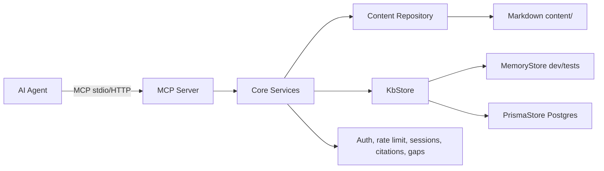

# UX-KB — UI/UX Designer Agent Knowledge Base

[](https://github.com/Vinoth82003/ux-kb-mcp/actions/workflows/ci.yml)
[](https://nodejs.org)
[](https://www.typescriptlang.org)
[](https://modelcontextprotocol.io)
[](https://www.prisma.io)
[](./LICENSE)

> **Cloud MCP knowledge base + UI/UX design agent.** 73 cited topic docs, 6 workflow
> stage packs, session-scoped retrieval, citation verification, API keys, rate limits,
> and usage/gap logging. Built with TypeScript, Prisma, and Postgres.

**Live page:** https://ux-kb-site.vercel.app

---

## Why UX-KB

Generic AI output looks like a template: default gradients, five-card grids, weak
hierarchy, no accessibility, and rules invented on the fly. UX-KB turns UX guidance
into a **queryable, versioned, citable knowledge base** that an agent must read
before proposing a design.

- Rules are **fetched, not memorized**. Every proposal cites doc IDs that were
  actually retrieved in the session.
- **Stage packs** load only the rules relevant to the current workflow stage, with
  token budgets, instead of dumping the whole catalogue.
- **Feature routing** pulls in extra docs for the specific thing being designed.
- **Citation verification** proves a cited ID was fetched — and flags unfetched,
  unknown, and deprecated IDs before submission.
- **Gap reporting** records missing topics instead of letting the agent invent rules.

---

## What's inside

| Surface | Count |
|---|---|
| Topic documents | 73 |
| Workflow stage packs | 6 (`need_check`, `research`, `audit`, `proposal`, `critique`, `implement`) |
| Feature routes | 10 |
| MCP tools | 7 |
| MCP resources | 3 |
| Core unit tests | 23 |

Content release candidate: `1.0.0-rc.1` (`content/release.json`).

---

## Architecture



- **MCP is the delivery layer; core owns the logic.** REST and admin (Phase 4) reuse
  the same services.
- **Agents read only published, immutable releases.** Each session pins one KB version.
- **Project design-system files override the KB** on tokens, brand, components, and voice.

---

## Quick start (no database)

```bash
cd ux-kb
pnpm install
pnpm lint:kb:strict   # 0 errors, 0 warnings across 73 docs
pnpm typecheck        # tsc across all packages
pnpm test             # 23 core unit tests
pnpm smoke            # 7 tools + 3 resources over MCP stdio
pnpm dev:mcp          # stdio MCP server
pnpm dev:web          # Next.js site + dashboard + /api/mcp (https in dev)
```

Node.js ≥ 20 and pnpm 10 are required. Postgres is optional for local dev.

---

## Connect an agent

### Claude Code (stdio)

```bash
claude mcp add ux-kb -- node --import tsx \
  /absolute/path/to/ux-kb/apps/mcp-server/src/index.ts
```

Or with the built server (`pnpm build` first):

```bash
claude mcp add ux-kb -- node /absolute/path/to/ux-kb/apps/mcp-server/dist/index.js
```

### Cursor / Claude Desktop

```json
{
  "mcpServers": {
    "ux-kb": {
      "command": "node",
      "args": ["--import", "tsx", "/absolute/path/to/ux-kb/apps/mcp-server/src/index.ts"]
    }
  }
}
```

### Streamable HTTP (with API key)

```bash
MCP_DEV_KEY=dev-local-key pnpm dev:mcp:http   # http://127.0.0.1:3333/mcp
```

```bash
claude mcp add --transport http ux-kb http://127.0.0.1:3333/mcp \
  --header "Authorization: Bearer dev-local-key"
```

---

## Tool reference

| Tool | Input | Output | Side effect |
|---|---|---|---|
| `start_session` | `feature` | `sessionId`, KB version, suggested IDs | creates session |
| `get_stage_pack` | `sessionId`, `stage` | stage docs + routed docs | records fetched IDs |
| `get_doc` | `sessionId`, `id` | one published doc | records fetched ID |
| `search_kb` | `query`, `domain?`, `limit?` | IDs, titles, summaries | none |
| `get_checklist` | `ids[]` | CHECK items only | none |
| `verify_citations` | `sessionId`, `citedIds[]` | unfetched, unknown, deprecated | stores result |
| `report_gap` | `topic`, `context` | acknowledgement | upserts gap |

Resources: `kb://doc/{id}`, `kb://pack/{stage}`, `kb://core`.

Stages: `need_check`, `research`, `audit`, `proposal`, `critique`, `implement`.

---

## Session workflow

1. Call `start_session` once per task.
2. Call `get_stage_pack` before each stage; `get_doc` for extra topics.
3. Call `verify_citations` before submitting — it compares cited IDs against the
   session's fetch history.
4. Call `report_gap` when the KB lacks a topic instead of inventing a rule.

`get_stage_pack` reports an estimated token count and marks over-budget packs
(characters / 4, not a model-specific tokenizer).

---

## Database (optional, for persisted auth/usage/gaps)

```bash
cp .env.example .env        # set DATABASE_URL, DIRECT_URL, KEY_HASH_SECRET, AUTH_SECRET
pnpm db:generate
pnpm db:push
pnpm db:seed
pnpm kb:keys create --name laptop --rate-limit 120
```

`KB_STORE=db` (or a non-empty `DATABASE_URL`) selects `PrismaStore`;
`KB_STORE=memory` forces the in-memory store used by tests and `smoke:http`.
`DIRECT_URL` is the non-pooled connection used by migrations; on Prisma Postgres it
is the direct (non-pooled) URL.
The seed is idempotent.

---

## Testing

```bash
pnpm lint:kb:strict   # 0 errors, 0 warnings across 73 docs
pnpm typecheck        # tsc, both packages
pnpm test             # 23 core unit tests
pnpm build            # tsup bundle
pnpm smoke            # stdio end-to-end
pnpm smoke:http       # HTTP auth, pinning, revocation, 429
```

See `docs/testing.md` for the full manual test guide.

---

## Project structure

```
ux-kb/
  content/                 Markdown knowledge base (source of truth)
  prisma/schema.prisma     DB schema (docs, versions, releases, keys, usage, gaps, rate limits)
  prisma/seed.ts           content/ -> Postgres
  packages/core/src/
    schemas/               zod front matter, packs, routes, releases
    content/               path resolution, parser, repository, token estimate
    services/              docs, packs + routing, search, release, auth,
                           rate limit (in-memory + Postgres), sessions/citations, gaps
    store/                 KbStore boundary: memory + Prisma implementations
    lint/                  doc + catalog linter
    cli/                   lint, info, key/gap commands
  packages/mcp/src/        MCP server factory, tools, resources (shared)
  apps/stdio/src/          stdio transport (local agents: Claude Code, Cursor)
  apps/stdio/scripts/      smoke.ts (stdio), http-smoke.ts (auth/429)
  apps/web/                Next.js app (public site, /api/mcp, /dashboard)
    app/                   App Router pages and route handlers
    lib/                   db, kb, store, auth, mcp auth helpers
    proxy.ts               route guard for /dashboard
```

---

## Web app (Next.js)

The public site, MCP endpoint, and admin dashboard ship as one Next.js app in
`apps/web`.

```bash
pnpm dev:web       # https://localhost:3000 (self-signed cert in dev)
pnpm build         # builds stdio + web
```

Surfaces:

- `/` — public landing page
- `/api/healthz` — health and KB version
- `/api/mcp` — Streamable HTTP MCP (Bearer API key, rate limited in Postgres)
- `/signin` — GitHub OAuth (allowlisted accounts only)
- `/dashboard` — keys, usage, gaps, releases (requires sign-in)

HTTPS is provided by Vercel in production (HSTS + security headers configured in
`next.config.ts`). Local dev uses `next dev --experimental-https`.

## Security and limitations

- The server trusts **reviewed Markdown**. A bad doc becomes an instruction the
  agent follows, so review is the security boundary.
- Citation verification proves **fetch history**, not that a source semantically
  supports a claim.
- Rate limiting is Postgres-backed in production (`RateLimitWindow`); the
  in-memory limiter remains for tests and local dev.
- Usage logs store tool arguments — avoid sending secrets in `feature`,
  `context`, or query text.
- Token estimates are approximate (±15% for prose); pack budgets are advisory.

---

## Roadmap

- Phase 4: admin docs, packs, releases (draft → review → publish)
- Phase 5: usage, compliance, and gap observability
- Phase 6: agent files, critic, evals, Playwright/axe
- Phase 7: CI regression and content expansion from ranked gaps

---

## Contributing

Issues and PRs welcome. Before submitting:

1. Keep doc changes minimal and justified.
2. Write docs in your own words — never paste copyrighted source text.
3. Run `pnpm lint:kb:strict`, `pnpm typecheck`, and `pnpm test`.

---

## License

Released under the [MIT License](./LICENSE). Content is a release candidate and
may change between versions.
